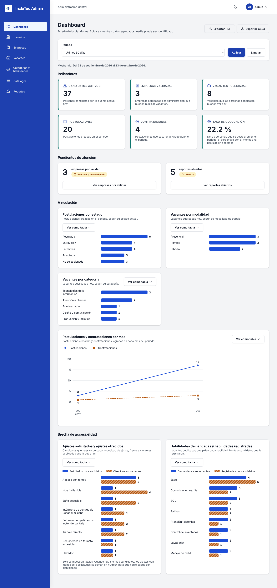

# IncluTec · Panel de administración (`web/`)

Panel web en Laravel (Blade) para el **administrador** de IncluTec: valida empresas, modera vacantes, atiende reportes, administra usuarios y catálogos y consulta estadísticas. **No tiene base de datos:** todo pasa por el API REST (`api/`) con JSON y un token JWT, que el panel guarda en la **sesión del servidor** y nunca manda al navegador.



Qué hace cada pantalla: `docs/diseno/pantallas.md` y `docs/diseno/requerimientos.md`. Rutas, cuerpos y errores del API: `docs/api/contrato.md`.

## Requisitos

- PHP 8.2 o superior con las extensiones habituales de Laravel (`mbstring`, `openssl`, `tokenizer`, `xml`, `ctype`, `curl`, `fileinfo`, `iconv`).
- Composer 2.
- Node 20.19 o superior y npm.

**Arch Linux:** Composer necesita la extensión `iconv`, que viene desactivada. Actívala una vez:

```bash
sudo sed -i 's/^;extension=iconv/extension=iconv/' /etc/php/php.ini
php -m | grep -i iconv   # debe imprimir: iconv
```

No hace falta `pdo_sqlite` ni ningún otro controlador de base de datos.

## Instalación

Desde `web/`:

```bash
composer install
cp .env.example .env
php artisan key:generate
npm ci
npm run build          # compila estilos, la fuente Inter y Alpine.js; sin este paso el panel no carga
```

### Variables de entorno (`.env`)

| Variable | Para qué sirve |
|---|---|
| `APP_NAME`, `APP_ENV`, `APP_KEY`, `APP_DEBUG`, `APP_URL` | Configuración básica de Laravel (`APP_URL` usa el puerto 8001). |
| `APP_LOCALE`, `APP_FALLBACK_LOCALE` | `es_MX`. La zona horaria es `America/Mexico_City` (las fechas del API vienen en UTC y se muestran en hora de la Ciudad de México). |
| `SESSION_DRIVER`, `CACHE_STORE`, `QUEUE_CONNECTION` | `file`, `file` y `sync`: no hay base de datos. |
| `INCLUTEC_API_URL` | Dirección del API, con `/api/v1`. Por omisión `http://localhost:8000/api/v1`. |
| `INCLUTEC_API_MOCK` | `true` usa datos simulados; `false` llama al API real. |
| `INCLUTEC_MOCK_ARCHIVO` | Opcional. Ruta del archivo donde el mock guarda su estado (por omisión `storage/app/mock-api.json`). |

## Cómo correr

El API usa el puerto 8000, así que el panel corre en el **8001**.

```bash
composer run dev                        # servidor (puerto 8001), registros y Vite
# o, por separado:
php artisan serve --port=8001
npm run dev                             # solo si vas a editar JavaScript; si no, basta npm run build
```

Abre http://localhost:8001. La raíz lleva al dashboard si hay sesión o al inicio de sesión si no.

## Mock o API real

Los controladores solo conocen la interfaz `ApiAdmin`; `ApiServiceProvider` entrega una de sus dos implementaciones según `INCLUTEC_API_MOCK`:

| | `INCLUTEC_API_MOCK=true` | `INCLUTEC_API_MOCK=false` |
|---|---|---|
| Implementación | `ApiMock`: responde con los datos de `db/semillas/S002__datos_prueba.sql` y los mismos códigos de error del contrato | `ApiHttp`: llama a `INCLUTEC_API_URL` con `Authorization: Bearer` |
| Cuándo | Hasta que el API exista (sprint 4) o para demostraciones | Con el API corriendo en el puerto 8000 |

Para pasar al API real: `INCLUTEC_API_MOCK=false` en `.env`, el API encendido y `php artisan config:clear`. Las pantallas no cambian. Si el API está apagado o responde 5xx, el panel muestra una página de error con el botón «Reintentar» (ver «Errores y sesión»).

### El mock tiene memoria

`ApiMock` guarda su estado (contraseñas, intentos fallidos y todo lo que el administrador cree o edite) en `storage/app/mock-api.json`. El archivo está fuera de git, se crea a partir de `app/Servicios/Api/Mock/datos.php` la primera vez que se usa y se actualiza con bloqueo de archivo. Así un cambio hecho en el panel se conserva al recargar.

```bash
php artisan inclutec:mock-reiniciar   # borra el archivo y vuelve a los datos de demostración
```

Datos de demostración que deja el reinicio (60 usuarios, 10 empresas, 34 vacantes, 39 reportes):

- Las fechas de postulaciones, vacantes y reportes son **relativas al día del reinicio** («hace 12 días»), así que el periodo por omisión del dashboard (30 días) siempre tiene datos. Pasados unos días, vuelve a correr el comando.
- Dashboard de los últimos 30 días: 37 candidatos activos, 3 empresas validadas, 8 vacantes publicadas, 20 postulaciones, 4 contrataciones y 22.2 % de colocación; 3 empresas por validar (Estudio Trazo entre ellas, que solo crea borradores) y reportes abiertos de los tres tipos (vacante, empresa y usuario).
- Las 3 páginas de usuarios (25 por página), las 2 de reportes resueltos y los filtros tienen volumen para probar la paginación. El relleno no mueve las estadísticas más allá de lo anterior.
- Si cambias `Mock/datos.php`, las llaves que falten se completan solas, pero los registros ya guardados no cambian: corre `inclutec:mock-reiniciar`.
- En las pruebas cada caso usa un archivo temporal propio (`tests/TestCase.php`), así que nunca tocan el archivo de desarrollo.
- Para depurar, el archivo se puede abrir y editar a mano (es JSON).

## Cuentas de prueba

Contraseña de todas: `Inclutec2026`. Son las de `db/semillas/S002__datos_prueba.sql` (sección 9 de `docs/CONTEXTO.md`). El panel solo deja entrar al administrador:

| Correo | Qué pasa en el panel |
|---|---|
| `admin@inclutec.mx` | Entra al dashboard. |
| `mariana.lopez@correo.mx`, `jorge.ramirez@correo.mx` (candidatos) y las cuentas de reclutador (`rh@tecnoqro.mx`, `rh@logibajio.mx`, `talento@concentro.mx`, `contacto@estudiotrazo.mx`) | «Esta cuenta no tiene acceso al panel. Usa la aplicación móvil.» y no se guarda la sesión. |
| `suspendida@correo.mx` | Existe solo en el mock (id 100): responde 423, «Tu cuenta está suspendida.». |
| `ana.torres@correo.mx`, `luis.fernandez@correo.mx`, `carmen.vazquez@correo.mx`, `miguel.cruz@correo.mx`, `daniela.morales@correo.mx`, `hector.salinas@correo.mx` | Candidatos solo del mock (ids 101 a 106) que dan volumen a las estadísticas. Tampoco entran al panel. |
| `nombre.apellido07@correo.mx`… (ids 107 a 152) | Usuarios de relleno del mock con roles y estados mezclados. Hay 3 administradores extra; todos entran con `Inclutec2026`. |

Con el mock, cinco intentos fallidos con el mismo correo bloquean el acceso 15 minutos: el sexto responde 429 con `Retry-After`, aunque la contraseña sea correcta.

## Mapa de pantallas

| Código | Pantalla | Ruta | Controlador |
|---|---|---|---|
| WEB-01 | Inicio de sesión | `/login` | `SesionController` |
| WEB-02 | Dashboard y estadísticas (con exportación a PDF y XLSX) | `/dashboard`, `/dashboard/exportar` | `DashboardController` |
| WEB-03 | Usuarios: lista, detalle, alta, edición y estado | `/usuarios`, `/usuarios/{id}`, `/usuarios/nuevo`, `/usuarios/{id}/editar` | `UsuarioController` |
| WEB-04 | Empresas y validación: pestañas por estado, revisión, alta y edición | `/empresas`, `/empresas/{id}`, `/empresas/nueva`, `/empresas/{id}/editar` | `EmpresaController` |
| WEB-05 | Vacantes (moderación): lista y detalle | `/vacantes`, `/vacantes/{id}` | `VacanteController` |
| WEB-06 | Categorías y habilidades | `/habilidades` | `HabilidadController` |
| WEB-07 | Catálogos (ocho tipos) | `/catalogos` | `CatalogoController` |
| WEB-08 | Reportes e incidencias: bandeja y detalle | `/reportes`, `/reportes/{id}` | `ReporteController` |
| — | Cambiar contraseña (menú de usuario) | `/perfil` | `PerfilController` |

WEB-06 y WEB-07 comparten un solo componente (`<x-catalogo>`), armado con la definición de `App\Support\Catalogos`; sus altas, ediciones y bajas van por `/catalogo/{clave}` (`ElementoCatalogoController`).

Capturas de cada pantalla, sus detalles, dos ventanas de confirmación y tres en modo oscuro están en [`docs/capturas/web/`](../docs/capturas/web/), con el código de la pantalla en el nombre (`WEB-04_Revision_empresa.png`).

## Arquitectura

```
app/
  Console/Commands/     inclutec:mock-reiniciar
  Http/
    Controllers/        un controlador por pantalla; SesionController maneja login y logout
    Middleware/         ExigirAdministrador (alias `admin`): exige sesión, valida el token con GET /auth/me y comparte `$administrador`
                        EncabezadosSeguridad: encabezados de seguridad en todas las respuestas
  Providers/            ApiServiceProvider elige ApiMock o ApiHttp según INCLUTEC_API_MOCK
  Servicios/Api/
    ApiAdmin.php        interfaz: lo único de lo que dependen los controladores
    ApiHttp.php         llama al API real (Bearer con el token de la sesión, 15 s de tiempo máximo)
    ApiMock.php         responde como el contrato con datos de prueba
    ApiError.php        excepción con status, codigo, detail y campos (forma del contrato)
    Mock/datos.php      datos iniciales del mock (los de S002 y el relleno); único lugar donde viven
    Mock/Almacen.php    estado persistente del mock
    Mock/CalculadoraEstadisticas.php, ExportadorEstadisticas.php   estadísticas, PDF (FPDF) y XLSX (SimpleXLSXGen) del mock
    Mock/Gestion{Usuarios,Empresas,Vacantes,Reportes,Catalogos}.php   reglas del contrato de cada grupo, con sus 409 y 422
  Support/              Estados (mapa de estados), Iconos, Fechas, Roles, Catalogos y los textos y formatos de cada pantalla
bootstrap/app.php       alias del middleware y manejo de errores (ApiError, 419)
config/inclutec.php     api_url, mock y mock_archivo
resources/
  css/admin.css         estilos del panel (con Vite); fuentes.css carga Inter desde @fontsource, sin internet
  js/                   app.js (Alpine + plugin focus) y componentes.js (avisos, modal, confirmación…)
  views/layouts/        admin_layout (pantallas con sesión) y publico (login y páginas de error sin sesión)
  views/components/     componentes Blade
  views/auth/, admin/   pantallas
  views/errors/         404 y error del API
  views/desarrollo/     guía de componentes (solo APP_ENV=local)
scripts/                verificaciones de accesibilidad y capturas (solo desarrollo)
tests/                  Feature (pantallas, errores, seguridad, sin internet) y Unit (ApiMock, ApiHttp, Estados, estadísticas)
```

Reglas del panel: las vistas nunca importan datos de prueba; siempre pasan por `ApiAdmin`. Rutas, campos, estados y errores siguen `docs/api/contrato.md`. El panel no usa Eloquent ni tiene conexión a base de datos.

## Errores y sesión

`bootstrap/app.php` convierte cada error en una pantalla clara, sin mostrar trazas:

| Situación | Qué ve la persona |
|---|---|
| API apagado o 5xx | Página «El servicio no está disponible» (HTTP 503) con el botón **Reintentar**, que repite la misma consulta (o vuelve al dashboard si venía de un envío). |
| 401 (token vencido o inválido) | Se cierra la sesión y se lleva a `/login` con «Tu sesión expiró. Vuelve a iniciar sesión.» |
| 423 | Se cierra la sesión: «Tu cuenta está suspendida.» |
| 403 | Página «No tienes permiso» con el mensaje del API; la sesión sigue abierta. |
| 404 de un detalle (`/usuarios/9999`) | La página 404 del panel, con el menú y un enlace al dashboard. |
| 419 (el formulario venció) | Regresa al formulario con «Tu formulario venció. Revisa los datos y vuelve a enviarlo.» y **conserva lo escrito** (nunca las contraseñas). |

Con `APP_ENV=local`, `/componentes/error/api`, `/componentes/error/permiso` y `/componentes/error/fuera` muestran las páginas de error sin necesidad de apagar el API.

## Seguridad

- Todos los formularios llevan `@csrf`; los que cambian datos usan `PUT`, `PATCH` o `DELETE` con `@method`.
- Al iniciar sesión se regenera el ID de sesión; al cerrarla (o al expirar el token) se invalida y se regenera el token CSRF.
- El token JWT vive solo en la sesión del servidor. Ninguna vista ni script lo recibe; la constancia fiscal se descarga mediante `/empresas/{id}/constancia`, que usa el token del lado del servidor. Una prueba revisa que no aparezca en el HTML de ninguna pantalla.
- `EncabezadosSeguridad` agrega a cada respuesta `X-Frame-Options: DENY`, `X-Content-Type-Options: nosniff`, `Referrer-Policy: same-origin` y una `Content-Security-Policy-Report-Only`.
- El panel no pide nada a internet: estilos, fuente Inter, íconos y JavaScript salen de `public/build`. Una prueba recorre todas las pantallas y falla si encuentra un `<script>`, `<link>`, imagen o fuente con otro host.

## Cómo construir una pantalla

Cada pantalla sigue estos pasos. **La vista nunca tiene datos escritos a mano ni llama al API: solo junta componentes con lo que le da el controlador.**

1. **Lee el diseño** (en este orden): la sección de la pantalla en `docs/api/contrato.md`, sus RF en `docs/diseno/requerimientos.md`, su caso de uso en `docs/diseno/casos_de_uso.md` y su sección en `docs/diseno/pantallas.md`. Usa los campos de `db/modelo/diccionario.md`; no inventes ninguno.
2. **Agrega los métodos a `ApiAdmin`** (uno por endpoint, con el endpoint en el comentario) y devuélvelos como arreglo con la forma del contrato. Impleméntalos en:
   - `ApiHttp`: una línea con `$this->enviar('get', '/admin/usuarios', $consulta)->json()`. Los errores ya llegan como `ApiError`.
   - `ApiMock`: lee y escribe con `Almacen::leer()` / `Almacen::modificar(function (array &$estado) { … })` y responde con **los mismos códigos de error del contrato**. Lanza el error después de guardar, no dentro de la función que modifica el estado.
3. **Agrega los datos al mock** en `Mock/datos.php` bajo una llave nueva, con los de S002 y los nombres de campo del contrato (snake_case, catálogos como `{id, nombre}`, fechas en UTC, relativas con `$hace()`). El volumen extra va con ids de 100 en adelante. Corre `php artisan inclutec:mock-reiniciar`.
4. **Crea o completa el controlador**: recibe `ApiAdmin` en el constructor, valida con `$request->validate()` (mensajes en español de México), llama al servicio y pasa el resultado a la vista. Captura `ApiError` solo para los errores que la pantalla maneja (409, 422…); el 401, 403, 404, 5xx y 423 ya los maneja `bootstrap/app.php`.
5. **Registra la ruta** dentro del grupo `Route::middleware('admin')` de `routes/web.php`, con nombre.
6. **Arma la vista** con el layout y los componentes. Un `<h1>` (con `<x-encabezado-pagina>`), filtros con `<x-filtros>`, tabla con `<x-tabla>`, estados con `<x-insignia-estado>`, paginación con `<x-paginacion>`, acciones críticas con `<x-confirmacion pedirMotivo …>`. Textos en español de México; fechas en hora de la Ciudad de México.
7. **Agrega la ruta a `scripts/lib/panel.mjs`** (lista `PAGINAS`) para que entre en las verificaciones de accesibilidad, y a `tests/Concerns/PaginasDelPanel.php` para las pruebas de seguridad y de recursos externos.
8. **Prueba**: pruebas de Laravel (sin sesión lleva a `/login`; caso feliz con el mock; cada error del contrato que la pantalla maneja; un `Http::fake` con la respuesta del contrato para `ApiHttp`; `<h1>` único), `npm run verificar:axe` y `npm run verificar:manual`.

### Layout y componentes

Todas las pantallas del panel extienden `layouts.admin_layout`:

```blade
@extends('layouts.admin_layout')
@section('titulo', 'Usuarios')      {{-- título de la pestaña: «Usuarios · IncluTec Admin» --}}
@section('content')
    <x-encabezado-pagina titulo="Usuarios" descripcion="…">…</x-encabezado-pagina>   {{-- el único <h1> --}}
    …
@endsection
```

El layout ya trae «Saltar al contenido», `<header>` con el menú de usuario (Cambiar contraseña, Cerrar sesión), `<nav aria-label="Menú principal">` con `aria-current="page"`, un solo `<main id="contenido" tabindex="-1">`, el menú plegable en pantallas angostas y las regiones de avisos. **No agregues otro `<main>` ni otro `<h1>`.**

Con `APP_ENV=local`, **http://localhost:8001/componentes** muestra todos los componentes con ejemplos (`resources/views/desarrollo/componentes.blade.php`).

| Componente | Para qué |
|---|---|
| `<x-encabezado-pagina titulo descripcion>` | `<h1>`, descripción y, en el slot, los botones de acción |
| `<x-boton variante="primario\|secundario\|peligro\|texto" tipo href :deshabilitado>` | Botones de al menos 44 × 44 px |
| `<x-insignia-estado entidad valor>` | Estado con texto e ícono, desde el mapa de `App\Support\Estados` |
| `<x-tabla caption :columnas mensajeVacio>` | `<table>` con `<caption>`, `<th scope="col">`, región con nombre enfocable (se desplaza con el teclado) y fila de estado vacío |
| `<x-paginacion :total :page :size>` | Recibe lo que devuelve el API; conserva los filtros de la URL |
| `<x-filtros buscar :selects :total>` | Formulario GET con «Aplicar» y «Limpiar»; anuncia el número de resultados |
| `<x-campo nombre etiqueta tipo valor ayuda obligatorio maximo :opciones>` | Etiqueta, control, ayuda, contador y error con `aria-invalid`/`aria-describedby`; toma el error de `$errors` |
| `<x-resumen-errores>` | Lista de errores con `role="alert"` que recibe el foco; cada error enlaza a su campo |
| `<x-modal id titulo>` | Diálogo accesible: foco atrapado, Escape y «Cerrar», devuelve el foco. Se abre con `$dispatch('abrir-modal', 'id')` |
| `<x-confirmacion id titulo pedirMotivo accion metodo>` | «¿Seguro que…?»; con `pedirMotivo` no deja confirmar sin motivo. Con `accion` envía un formulario; sin ella emite el evento `confirmado` |
| `<x-usuario-botones>` / `<x-empresa-botones>` / `<x-vacante-botones>` / `<x-reporte-botones>` y sus `*-confirmaciones` | Acciones de estado de cada entidad y sus confirmaciones, que se dibujan fuera de la tabla |
| `<x-catalogo :clave :filas :grupos :opciones>` | Administrador de un catálogo (tabla con «En uso» y estado, alta y edición en ventana, activar o desactivar, eliminar). Lo usan WEB-06 y WEB-07 |
| `<x-grafica :grafica>` | Gráfica del dashboard (barras o líneas) dibujada en el servidor, con valores escritos y el botón «Ver como tabla» |

**Avisos.** Un controlador que termina bien redirige con `->with('exito', '…')`; si algo falla sin ser un error de campo, con `->with('error', '…')`. El layout muestra `exito` en una región `role="status"` y `error` en una `role="alert"`. Los errores de campo usan `->withErrors()` y `<x-resumen-errores>`.

**Estados.** El texto, el ícono y el color salen **solo** de `App\Support\Estados` (tabla 3.4 de `docs/diseno/pantallas.md`): `<x-insignia-estado entidad="empresa" valor="pendiente" />`. Nunca escribas «Revisión», «Bloqueado» u otros textos a mano. Si el contrato agrega un valor, `tests/Unit/EstadosTest.php` falla hasta que se agregue al mapa.

## Calidad

```bash
php artisan test           # pruebas
./vendor/bin/pint --test   # estilo (Laravel Pint); sin --test corrige los archivos
npm run build              # compila el JavaScript y los estilos
npm audit                  # dependencias de JavaScript
```

### Accesibilidad (WCAG 2.1 AA)

Los scripts de `scripts/` usan Playwright y axe-core (dependencias de desarrollo). Necesitan el panel con el mock; si no hay uno corriendo en `BASE_URL` (por omisión `http://localhost:8001`), arrancan uno propio con datos temporales.

```bash
npx playwright install chromium     # una sola vez
npm run build
npm run verificar:axe               # axe-core en todas las pantallas, claro y oscuro, también con cada ventana abierta
npm run verificar:manual            # lo que axe no revisa (ver abajo)
```

| Variable | Para qué |
|---|---|
| `BASE_URL` | Panel contra el que corren los scripts. |
| `SOLO` | Texto para auditar solo las páginas cuyo nombre lo contenga (`SOLO=Reporte npm run verificar:axe`). |
| `ARBOL` | Carpeta donde `verificar:manual` guarda el árbol de accesibilidad de cada página (lo que leería un lector de pantalla). |
| `CHROMIUM_PATH` | Chromium del sistema (`/usr/bin/chromium`) si el de Playwright no está instalado o no arranca. |

`verificar:axe` audita 38 páginas (login, dashboard, usuarios, empresas, vacantes, reportes, categorías, habilidades, catálogos, perfil, 404 y error del API) en claro y oscuro, y repite la auditoría con cada ventana abierta y con sus errores visibles. El resultado esperado es **0 hallazgos**.

`verificar:manual` comprueba lo que axe no puede: reflujo a 320 px y a 200 % de zoom (sin desplazamiento horizontal fuera de las tablas), menú lateral con teclado (abrir, Escape, foco atrapado y devuelto), `prefers-reduced-motion`, `<title>` único con el formato «Usuarios · IncluTec Admin», un solo `<h1>`, encabezados en orden, foco visible en claro y oscuro y nombre accesible de todo control. Una revisión con lector de pantalla (Orca + Firefox) sigue siendo recomendable antes de la entrega: el árbol que guarda `ARBOL` sirve para prepararla.

### Capturas

```bash
npm run capturas       # regenera docs/capturas/web/*.png (1440 × 900 de ancho, con el mock)
SOLO=Dashboard npm run capturas
```

Reinicia el mock antes (`php artisan inclutec:mock-reiniciar`) para que las cifras coincidan con las de este README. Si Playwright no encuentra su Chromium, usa `CHROMIUM_PATH`.

## Dependencias y auditoría

`npm audit` en `web/` reporta **0 vulnerabilidades**. El JavaScript del panel usa Vite, `laravel-vite-plugin`, Alpine.js y la fuente Inter; Playwright y axe-core son solo de desarrollo. No hay `overrides` ni excepciones. Si aparece algo, corrígelo con `npm audit fix` y nunca con `npm audit fix --force`: puede saltar de versión mayor y romper el build. Tras tocar dependencias, `npm run build` y `php artisan test` deben seguir en verde. Las bibliotecas de Composer `setasign/fpdf` y `shuchkin/simplexlsxgen` (un solo archivo, sin extensiones) generan el PDF y el XLSX del mock.

## Decisiones

- **El panel no tiene base de datos.** Sesión, caché y colas usan archivos; el estado del mock vive en un JSON.
- **Gráficas en el servidor, sin biblioteca de JavaScript.** SVG y HTML con `<x-grafica>`: cada gráfica trae sus valores escritos y una tabla alternativa, y la segunda serie se distingue por trama, no solo por color.
- **Un solo componente para WEB-06 y WEB-07**, porque los diez catálogos comparten estructura; lo que cambia se declara en `App\Support\Catalogos`.
- **La constancia fiscal pasa por el panel** (`/empresas/{id}/constancia`) para que el navegador nunca reciba el token.
- **Si una empresa no subió constancia**, la ruta responde la 404 del panel con ese mensaje, en vez de dejar un enlace roto.
- **CSP solo en modo informativo (`Report-Only`).** Alpine.js necesita `unsafe-eval` y los estilos de las gráficas son en línea; una CSP que bloqueara rompería el panel. La política publicada (`default-src 'self'`, `script-src 'self' 'unsafe-eval'`, `style-src 'self' 'unsafe-inline'`, `frame-ancestors 'none'`, `form-action 'self'`…) deja ver en la consola lo que se saldría de ella. Para endurecerla habría que usar la compilación de Alpine sin `eval` (`@alpinejs/csp`), lo que queda fuera de esta etapa.
- **Dos acciones de la pantalla de reportes** siguen la tabla de transiciones del contrato: un reporte abierto solo se toma en revisión o se descarta; «Resolver» aparece cuando ya está en revisión.
- **Relleno del mock acotado.** Los usuarios, vacantes y reportes de relleno existen para probar paginación y filtros; las postulaciones de relleno (con fechas repartidas en 85 días) hacen creíble el dashboard sin cambiar las cuentas de S002.
- **Los 401 del mock** usan el mismo mensaje que mostrará la pantalla («Tu sesión expiró. Vuelve a iniciar sesión.») para que el comportamiento sea idéntico con el API real.
